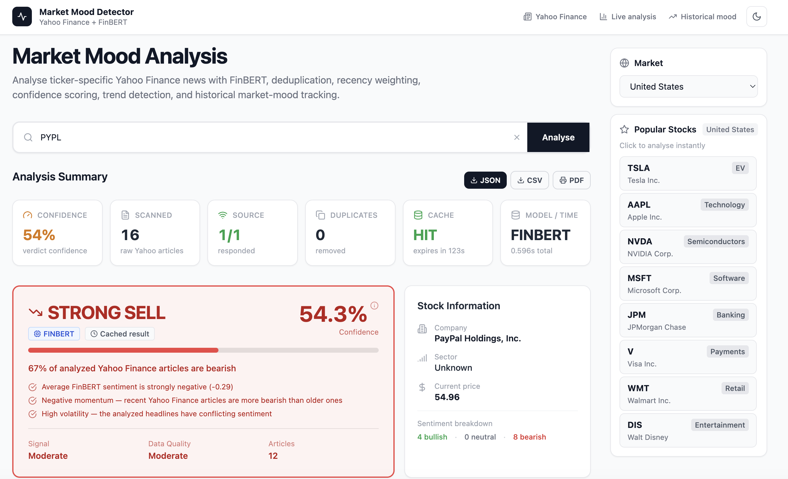

# Market-Mood-Detector


A financial sentiment dashboard that analyses current stock news with FinBERT, generates confidence-backed market-mood signals, and visualises historical sentiment trends.



<!-- Overview -->
## Overview
The system fetches news stories from Yahoo Finance's RSS feeds, removes repeated stories, scores each article with the FinBERT model, and aggregates everything into a Buy/Hold/Sell verdict.

| Feature | Implementation |
|---------|---------------|
| Deduplication | MD5 exact hash + `SequenceMatcher` fuzzy match |
| Financial NLP Model | FinBERT classifies financial text as bullish, neutral, or bearish |
| Confidence model | Weighted formula considering signal strength, agreement, volume, quality and recency |
| Trend tracking | Compares current entry with last SQLite entry |

**Backend:** FastAPI · Uvicorn · Pydantic · httpx · FinBERT · feedparser · SQLite \
**Frontend:** React 18 · Vite · Tailwind CSS · Recharts · Axios · Lucide React \
**Infrastructure:** Docker \
**Testing:** Pytest

<!-- GETTING STARTED -->
## Getting Started
#### Prerequisites
- Python 3.11+
- Node.js 18+
- npm
- Docker (optional, for containerised deployment)
---
Clone the repo
   ```sh
   git clone https://github.com/Anonymous893/Market-Mood-Detector.git
   ```

### Docker
```sh
docker compose up --build
```
- Frontend → http://localhost:3000
- Backend API → http://localhost:8000

### Installation For Local Dev
#### Backend
   ```sh
   # Go to the backend directory
   cd backend

   # Create and activate virtual environment
   python -m venv venv

   # 1. Mac/Linux
   source venv/bin/activate

   # 2. Windows
   venv\Scripts\activate

   # Install Python dependencies
   pip install -r requirements.txt
   ```

#### Frontend
   ```sh
   # Go to the frontend directory
   cd frontend

   # Install dependencies
   npm install
   ```

#### Running
In separate terminals:
1. Terminal 1
    ```
    cd backend
    uvicorn main:app --reload
    ```
2. Terminal 2
    ```
    cd frontend
    npm run dev
    ```

#### For Docker Build
   ```sh
   # Backend
   docker build -t market-mood-backend .
   docker run --rm -p 8000:8000 market-mood-backend

   # Frontend
   docker build --build-arg VITE_API_URL=http://localhost:8000 -t market-mood-frontend .
   docker run --rm -p 3000:80 market-mood-frontend
   ```

#### Run Tests
```sh
cd backend
pip install -r requirements-dev.txt
pytest
```

## Explanations
### Sentiment Analysis

Market Mood Detector uses **FinBERT**, a transformer-based NLP model designed for financial text, to classify the sentiment of each news article as **bullish, neutral, or bearish**.

Each article receives a sentiment score between **-1 and +1**:

| Score | Interpretation |
|-------|----------------|
| `-1.0` | Strongly bearish |
| `0.0` | Neutral |
| `+1.0` | Strongly bullish |

The system gives more influence to stronger and more recent signals. Neutral articles are filtered so that weak signals do not disproportionately affect the overall market mood. Recent articles also receive greater weight than older articles.

The resulting scores are aggregated to produce an overall sentiment signal for the selected ticker.

### Market-Mood Score and Verdict

The aggregated sentiment is converted into a market-mood verdict:

- **STRONG BUY** — strongly positive market sentiment
- **BUY** — positive market sentiment
- **HOLD** — relatively neutral or mixed sentiment
- **SELL** — negative market sentiment
- **STRONG SELL** — strongly negative market sentiment
- **INSUFFICIENT DATA** — not enough reliable information to produce a meaningful signal

The verdict is based on the strength and direction of the aggregated news sentiment rather than on stock-price prediction.

### Confidence Score

The confidence score measures how strong and reliable the available news-based evidence is for the current market-mood signal.

The score combines six factors:

| Component | Weight | Purpose |
|-----------|--------|---------|
| Signal magnitude | **35%** | Measures how far the overall sentiment is from neutral |
| Consensus strength | **25%** | Measures how consistently articles agree with the overall signal |
| Article volume | **15%** | Measures how much relevant news is available |
| Source quality | **10%** | Accounts for the reliability of the available news source |
| Recency | **10%** | Gives greater importance to current news |
| Signal stability | **5%** | Measures how consistent the sentiment signal is across the collected articles |

The components are normalised and combined into a single score from **0–100%**.

### Trend Detection

Each completed analysis is stored in a local SQLite database. Future analyses for the same ticker can therefore be compared with previous results.

The system compares the current analysis with the most recent historical entry and tracks changes in *average sentiment, confidence score, market mood verdict*.

The resulting trend is classified as:

- **Improving** — sentiment or confidence has moved in a more positive direction
- **Deteriorating** — sentiment or confidence has moved in a more negative direction
- **Stable** — the signal has changed very little
- **New** — no previous analysis exists for comparison

Historical results are displayed in the dashboard so users can see how the market mood has changed over time.

### News Deduplication

News feeds can contain repeated or highly similar stories. To prevent a single story from disproportionately influencing the analysis, the backend performs two levels of deduplication:

1. **MD5 hashing** identifies exact duplicate articles.
2. **`SequenceMatcher` fuzzy matching** identifies articles whose text or titles are highly similar even when they are not exactly identical.

Only the remaining unique articles are passed to the sentiment-analysis pipeline.

## Architecture

Market Mood Detector follows a frontend/backend architecture. The React application is responsible for presentation and user interaction, while the FastAPI backend handles data collection, NLP analysis, scoring, and persistence.

```text
User
Enter ticker symbol
   |
   |---> React Frontend
         Search / Dashboard / Charts / History / Loading
         |
         |---> HTTP / REST API
               /analyze/{ticker}, /history/{ticker}, /analytics/{ticker}
                    ┌─────────────────┼─────────────────┐
                    ▼                 ▼                 ▼
          ┌────────────────┐ ┌────────────────┐ ┌────────────────┐
          │  Yahoo Finance │ │    FinBERT     │ │ SQLite         │
          │      RSS       │ │ Sentiment NLP  │ │ History        │
          │ News articles  │ │ Article scores │ │ Past analyses  │
          └───────┬────────┘ └───────┬────────┘ └───────▲────────┘
                  └──────────┬───────┘                  │
                             ▼                          │
                    ┌──────────────────┐                │
                    │Analysis Pipeline │                │            
                    │ Deduplication    │────────────────┘
                    └────────┬─────────┘
                             ▼
         ┌────────────────────────────────────────────────────────────┐
         │                       JSON Response                        │
         | Verdict, Confidence, Sentiment, Statistics, Trend, History │
         └────────────────────────┬───────────────────────────────────┘
                                  ▼
                            React Dashboard
```